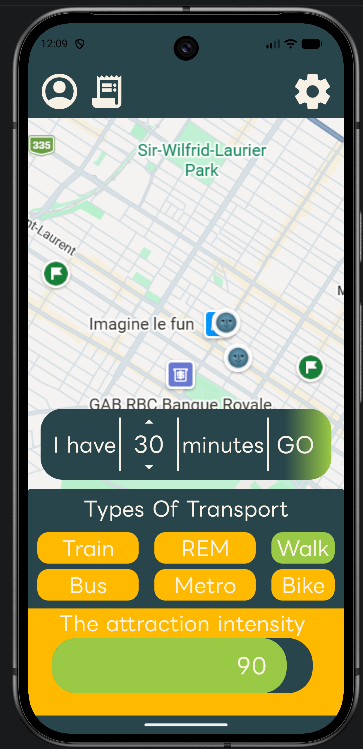
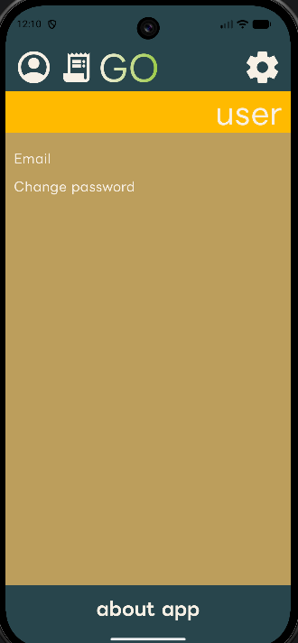
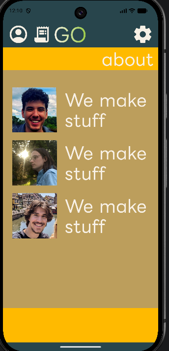

# RNDTransitMTL

## Goal

RNDTransitMTL is a Kotlin Multiplatform discovery app for Greater Montréal. Its goal is to generate semi-random adventures based on the user's available time, transportation choices, and interests, helping them explore unfamiliar places without choosing a destination first.

The Android prototype includes Supabase sign-in, a map-based trip planner, real street/path and transit routes, simulated trip progress, reviews with optional image links, and History with review editing and trip details. Profile, About, and Settings remain available. See the [main design document](docs/MainDesignDoc.md) for planned features and [team practices](docs/TeamPractices.md) for working agreements.

## How the project runs

The Android app and routing server run separately. In the current setup, a second
Windows PC runs **RNDTransitServer.exe**, while Android Studio on the development
PC builds and runs the app on an emulator or phone.

| Component | Role | Default address on the server PC |
| --- | --- | --- |
| Windows launcher | Starts/stops services and displays status and logs | Desktop application |
| Kotlin/Ktor backend | Generates destinations, asks OTP for routes, checks settings and time, and returns the accepted route as JSON | `http://127.0.0.1:18088` |
| OTP | Calculates street/path routes and STM/exo train journeys from the prepared graph | `http://127.0.0.1:18085` |
| STM/exo bridge | Handles realtime feeds, freshness and scheduled fallback | `http://127.0.0.1:18086` |
| Cloudflare / Microsoft Dev Tunnels (optional) | Makes Ktor reachable through public HTTPS | Shown under **Public HTTPS** in the launcher |

The phone sends its origin, time, modes, zones and walking pace to Ktor. Ktor chooses
candidate destinations, OTP calculates routes, and Ktor returns one valid itinerary.
The app draws its geometry and displays legs, distance and duration. Supabase
provides account authentication; the public generation API requires the signed-in
user's session token. OTP and the bridge stay private to the server PC.

The server PC, services, tunnel and internet connection must stay running for remote
trip generation. Android Studio does not start the server. `127.0.0.1` refers to
the device making the request; it is not the second PC's address from a phone.

## Trip and review flow

1. Sign in. Guest mode is available for local development, but cannot use the authenticated public generation API.
2. Confirm a starting point on the map or use an in-area device location. Choose time, transportation, zones and walking pace, then press **GO**. You can resume an active trip after navigating away.
3. Review the real route. **Generate another** changes the destination while preserving the origin; **Start Trip** keeps the accepted route. Legs use different colours, and the active-trip panel shows the current leg and next action. Progress is still simulated.
4. At completion, tap the 100% progress bar to open the review. Give an overall rating, optionally answer the other questions, add a comment or an HTTPS image link, then save or skip.
5. Open History to filter completed trips, expand saved feedback, view details, edit a review, or remove a trip. Review photos load when saved feedback is displayed, with retry and browser fallback controls.

The backend samples arbitrary coordinates, including parks; OTP must find a connected
route. Amble, Walk and Dash use 3, 4.8 and 6.8 km/h. Travel and waiting plus one minute
per routed kilometre must fit the selected budget. Attraction intensity is stored
but does not yet rank destinations. Desktop/Web previews retain built-in samples
unless configured with a generation endpoint. Trips and review drafts support
saved-state restoration; this flow does not add permanent trip storage. See the
[backend generation guide](docs/BackendTripGeneration.md) for exact rules and coverage.

The trip/review flow originated in [Artiom's Assignment 3 repository](https://github.com/NewWaveOwl/As3_APPDEV2_RND_Tranzit_Sova/tree/8b1b538) and has since been integrated with the real-route backend. Earlier screenshots remain historical material.

## Quick-start

### Requirements

- Android Studio with support for the project's Android Gradle Plugin version, listed in `gradle/libs.versions.toml`.
- JDK 21 selected as the Gradle JDK.
- Android SDK Platform 37 and Android SDK Platform-Tools.
- An Android emulator or device running Android 7.0 / API 24 or newer.
- Internet access for dependencies, sign-in, map data and remote trip generation.
- A running configured routing server for Android trip generation.

### Get the source

```powershell
git clone https://github.com/NewWaveOwl/RNDTransitMTL.git
cd RNDTransitMTL
```

Open this repository folder in Android Studio, let Gradle sync, and install any requested SDK components. Use the included Gradle wrapper; a separate Gradle installation is not required.

### Start the server on its Windows PC

1. Extract the complete portable package and run **RNDTransitServer.exe**. Keep its
   `app`, `runtime` and `services` folders beside the EXE. Java, Ktor, OTP and the
   bridge are bundled; Android Studio and Node.js are not required on this PC.
2. On first run, click **Setup / import**, select the prepared `stm-scheduled`
   folder, and choose a separate empty destination. Inputs include the combined
   `graph.obj`, STM/exo schedules, adapter index and local feed configuration.
   The launcher copies these inputs and preserves the source folder.
3. Click **Start server** and wait for **Bridge**, **OTP** and **Ktor** to show
   **Ready**. The imported location is saved as `dataDirectory` in Configuration.
   Check **Realtime feeds** for each agency's prediction/alert freshness and last
   successful update. **Bridge: Ready** alone does not confirm live API access.
   To replace keys, stop the server and use **Feed credentials...**, then Start.
4. For a phone/emulator on another PC, choose Cloudflare or **Microsoft Dev Tunnels (Azure)** in **Tunnel settings**
   and wait for **Tunnel: Connected**. Use its **Public HTTPS** address in the app.
   Public mode requires the same Supabase project URL and publishable key as
   Android, plus a signed-in user. Do not use a service-role key.

Use `tunnelMode=quick` for a temporary testing address, or a configured named tunnel
for a stable hostname. Quick Tunnel addresses change when the tunnel restarts:
update the app endpoint and rebuild/reinstall. See the
[Windows server guide](backend/launcher/SERVER_GUIDE.md) for configuration, imports,
tunnel setup and packaging.

For Microsoft, install the official `devtunnel` CLI once on the server PC. In
**Tunnel settings**, reuse an existing persistent ID (for example `rndtransit.use`)
or use the sign-in and creation buttons for a new tunnel. Select
`tunnelMode=microsoft`; Start server then hosts it and shows the checked public
HTTPS address. Close any manual `devtunnel host` first. No separate PowerShell
window is needed afterward. Microsoft tunnel URLs are reusable, subject to the
service's inactivity expiration; the server PC still needs to stay on.

The portable package is generated under `backend/launcher/build/`; obtain it from
the developer or build it using the guide. Cloning Git does not download it.
Generated EXEs, APKs, ZIPs, runtimes and build folders are not committed. Graphs
and local feed credentials must be prepared/transferred separately and kept out of Git.

### Build and launch Android in Android Studio

In the repository root's **`gradle.properties`**, add your current server URL:

```properties
# Local backend endpoint; replace YOUR-HOST with the launcher's Public HTTPS host
generationEndpoint=https://YOUR-HOST/v1/trips/generate
```

Keep the existing Kotlin, Gradle and Android settings. Save and **Sync Gradle**.
The endpoint is embedded at build time; an installed APK does not pick up later
property edits. Leave personal/temporary endpoint edits uncommitted. Use the current
launcher address rather than another developer's old `trycloudflare.com` URL.

Without this setting, Android debug builds default to `http://10.0.2.2:18088` on
the emulator's host PC. That default does not connect to a server on a second PC.

Select the `androidApp` run configuration and an emulator or connected device, then click **Run**. This builds and installs the debug version from source.

Alternatively, from the repository root in PowerShell, with a device or emulator connected:

```powershell
.\gradlew.bat :androidApp:installDebug '-PgenerationEndpoint=https://YOUR-HOST/v1/trips/generate'
adb shell am start -n com.example.rnd_transit_mtl/.MainActivity
```

For a physical device, enable USB debugging. If `adb` is not on your PATH, run it from your Android SDK's `platform-tools` folder.

### Alternative: all services on the development PC

Use this manual workflow when developing services without the portable launcher.
It requires JDK 21 for Ktor, the separate Java 25 OTP runtime, a prepared combined
graph and feed configuration. Start the stack, then Ktor in another PowerShell
window, and install into a running emulator:

```powershell
.\backend\otp\stm-scheduled\Start-StmRealtimeStack.ps1
# In another window:
.\backend\scripts\Start-TripBackend.ps1
# In a third window:
.\backend\scripts\Install-GeneratedTripAndroid.ps1 -Emulator
```

The installer sets a local endpoint and uses `adb reverse`. Use `-Phone` for an
authorized USB phone. Do not also launch another stack on the same ports. See the
[backend guide](docs/BackendTripGeneration.md) for prerequisites, a stack in another
checkout and detailed checks.

### Build and launch a release

Build the release variant from source:

```powershell
.\gradlew.bat :androidApp:assembleRelease '-PgenerationEndpoint=https://YOUR-HOST/v1/trips/generate'
```

The output is in `androidApp/build/outputs/apk/release/`. The project currently has no release signing configuration, so this command produces an unsigned APK.

To create an installable release, use Android Studio's **Build → Generate Signed Bundle / APK**, choose **APK** and the `androidApp` module, create or select a signing key, and choose the **release** variant. Install the resulting signed APK on your device, then launch RNDTransitMTL from the app launcher. You can also install and launch it using:

```powershell
adb install -r "PATH_TO_SIGNED_RELEASE_APK"
adb shell am start -n com.example.rnd_transit_mtl/.MainActivity
```

Replace `PATH_TO_SIGNED_RELEASE_APK` with the actual signed APK path. When switching from a debug build to a release signed with a different key, uninstall the debug app first; uninstalling removes its local app data.

### Other platforms

From the repository root:

- Desktop: `.\gradlew.bat :desktopApp:run`
- Web with Wasm: `.\gradlew.bat :webApp:wasmJsBrowserDevelopmentRun`
- Web with JavaScript: `.\gradlew.bat :webApp:jsBrowserDevelopmentRun`
- iOS: on macOS, open `iosApp/iosApp.xcodeproj` in Xcode, select a simulator or device, and run the app.

On macOS or Linux, use `./gradlew` in place of `.\gradlew.bat`.

### Regression tests and compilation checks

```powershell
.\gradlew.bat :backend:test :backend:launcher:test :shared:jvmTest :shared:testAndroidHostTest
.\gradlew.bat :androidApp:assembleDebug :shared:compileKotlinJs :shared:compileKotlinWasmJs
```

Tests cover backend generation/authentication, launcher lifecycle, trip/review state,
navigation, History, simulation and map geometry. Backend and launcher checks also
run independently of Android: `.\gradlew.bat -p backend test :launcher:test`.
iOS compilation requires macOS and Xcode.

## Earlier milestone screenshots

### Main map and trip controls



### User profile



### About



These screenshots show the earlier milestone UI. They have not been refreshed for the imported trip and review flow.

## Team members

- Artiom Sova
- Caio Nunes
- Jimmy Rashid
