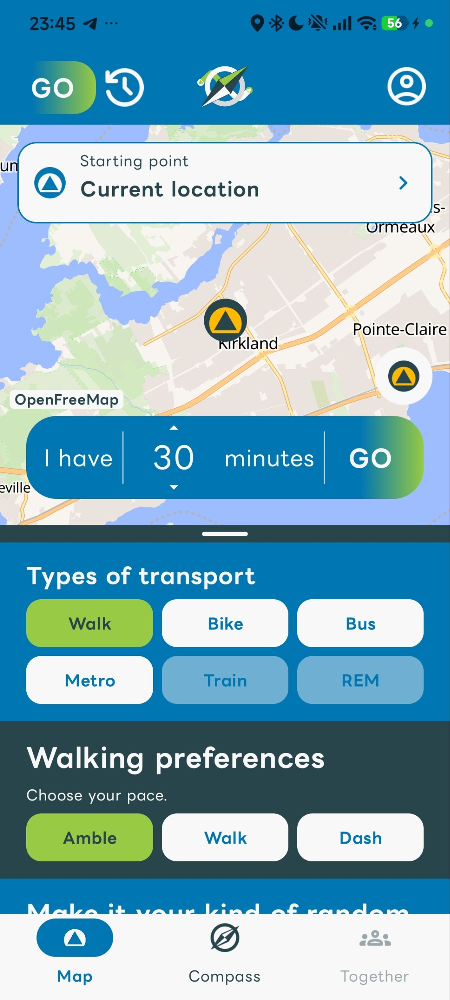
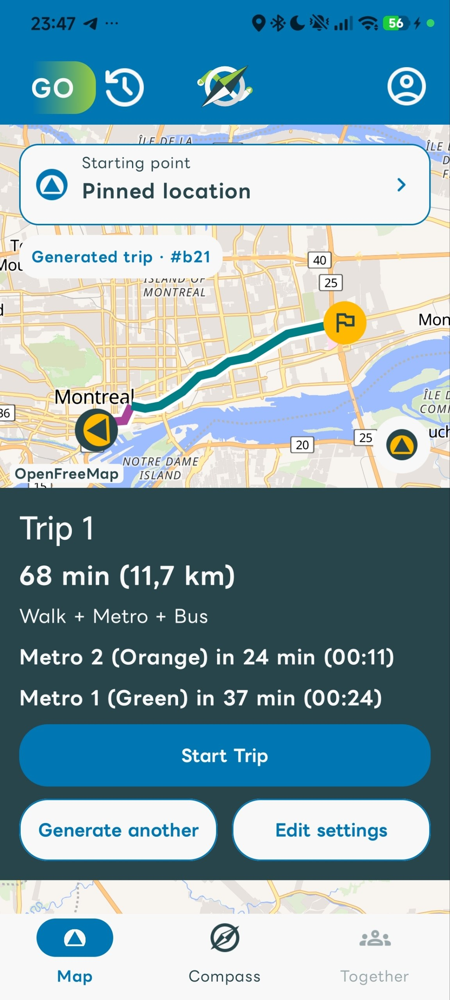
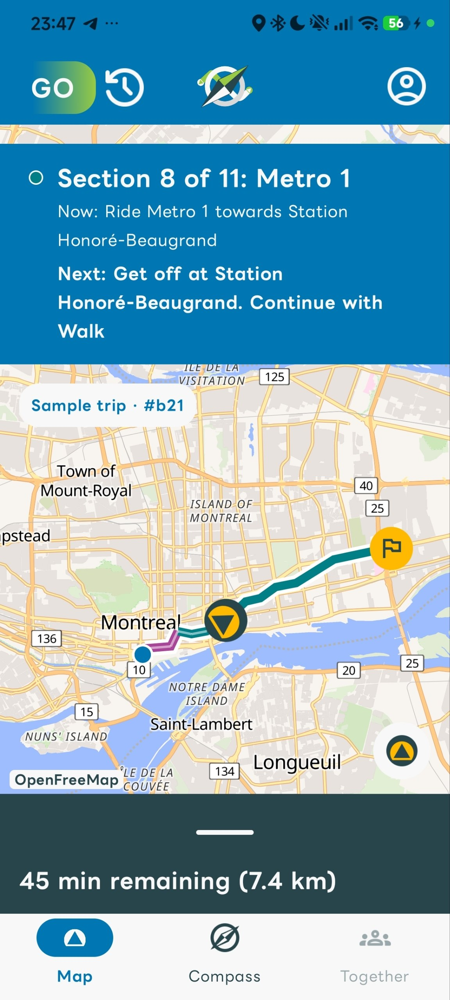
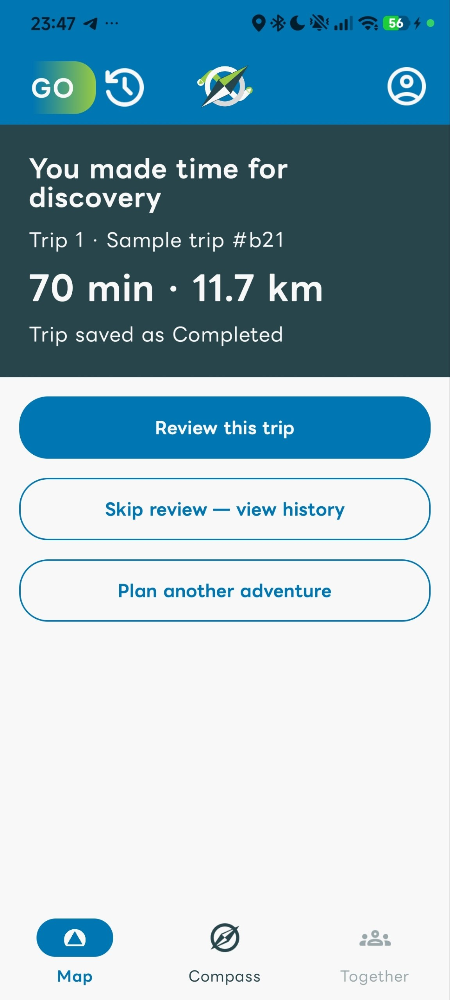
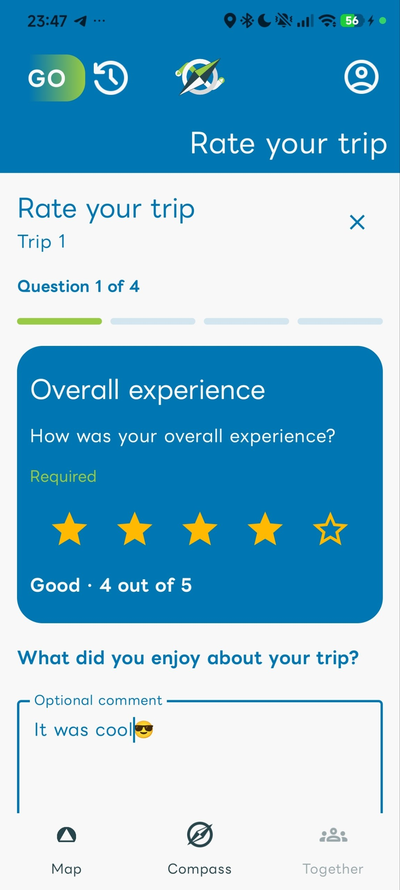
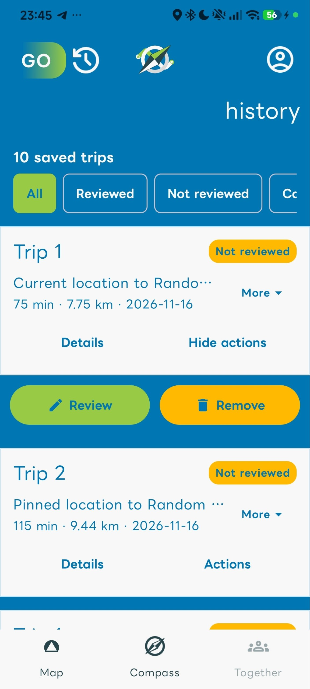
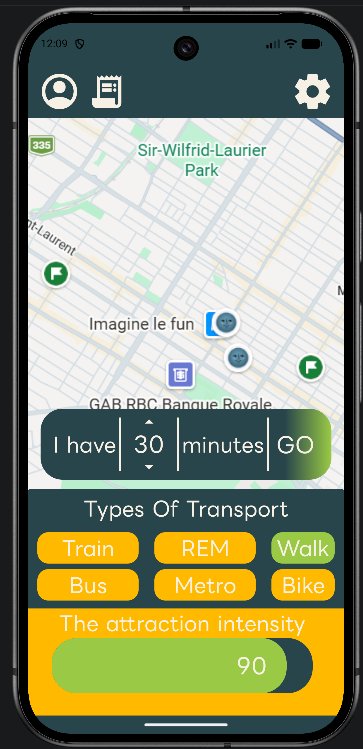
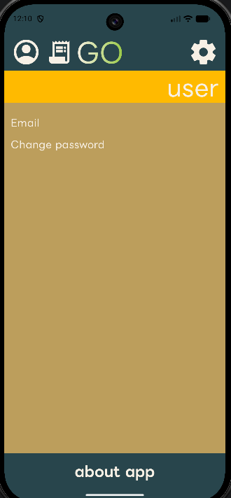
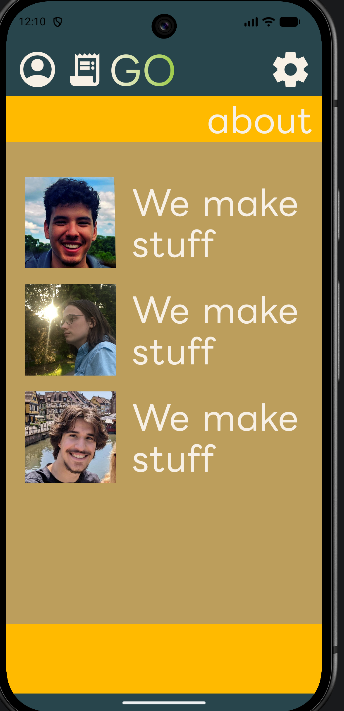

# RNDTransitMTL

RNDTransitMTL is a discovery app for Greater Montreal. Choose how much time you
have, how you want to travel, and where to start. The app finds a route to a
surprise destination so you can explore without planning the destination first.

Built with Kotlin Multiplatform, the current Android prototype combines a map-based
planner, real walking/cycling and transit routes, Supabase account sign-in,
persistent trips and reviews, and History. Android is the primary development
target; Desktop, Web and iOS targets are also included in the project.

## What you can do

- Choose your starting point on the map or use your device location.
- Set your available time, walking pace, transport choices and transit zones.
- Preview route geometry, duration, distance and transport modes before starting,
  or generate another destination from the same origin.
- See transit line details and departure estimates in the preview, including
  metro line colours when available.
- Follow coloured trip sections with the current section and next action displayed.
- Save completed and cancelled trips to your account through Supabase.
- Rate trips across four questions, add comments or an image link, and revisit
  or edit reviews in History.
- Filter History, open trip details, edit saved trip information, or remove trips.

## Plan an adventure

1. Sign in, confirm a starting point and choose your trip preferences.
2. Press **GO**. The app searches for a reachable route close to your available
   time without exceeding it. Selected transport modes are allowed alternatives;
   walking connections are available for transit.
3. Review the proposal. **Generate another** keeps your starting point and looks
   for another destination; **Start Trip** keeps the route you accepted.
4. Follow the current section and next action while the trip simulation runs.
5. On the completion screen, choose **Review this trip**, **Skip review — view
   history**, or **Plan another adventure**. Saved trips remain accessible in
   History for details and later reviews.

## Android availability

APK distribution is planned. For now, developers can build and install the Android
app from source using the [Android development guide](docs/AndroidDevelopment.md).
APK download and installation details will be added here when a release is published.

The current app requires Android 7.0 / API 24 or newer and internet access for
sign-in, maps and trip generation. Remote trip generation requires a running
configured server and a signed-in account. Guest mode is available for local
development; it cannot access the authenticated public generation service.

## Current prototype limits

Trip progress is **simulated**; this is not live GPS navigation. Route timing and
realtime estimates can change after a trip is generated. Available transit routes
depend on the server's imported schedules and configured feeds.

Attraction preferences are saved but do not yet rank destinations. The Compass
screen is a demonstration UI; live compass navigation and the Together feature
are not implemented. Desktop and Web previews use sample trips unless connected
to a generation service.

Account trip and review storage requires a configured Supabase project with the
repository migrations applied. Cloud synchronization can fail when the network
or service is unavailable; check the app’s save status and retry feedback.

## Project documentation

- [Android development, APK builds and client tests](docs/AndroidDevelopment.md)
- [Backend setup, server updates and hosting](backend/README.md)
- [Routing rules and generation verification](backend/TripGeneration.md)
- [Trip playback and guidance checks](docs/RunTripSimulation.md)
- [Design document and planned features](docs/MainDesignDoc.md)
- [Team practices](docs/TeamPractices.md)

The trip/review flow originated in
[Artiom's Assignment 3 repository](https://github.com/NewWaveOwl/As3_APPDEV2_RND_Tranzit_Sova/tree/8b1b538)
and has since been integrated with the real-route backend.

## Milestone 3 - Code Contribution

| Contribution | Artiom | AI |
| --- | ---: | ---: |
| UI - original mock-ups and design | 7,312.41 (63%) | 4,294.59 (37%) |
| Other app logic, maps and integration | 3,039.24 (62%) | 1,862.76 (38%) |
| App tests | 606.34 (14%) | 3,724.66 (86%) |
| **Total code contributed excluding AI Level-Up** | **10,957.99 (52.6%)** | **9,882.01 (47.4%)** |
| **AI Level-Up - excluded from total** | **428.08 (8%)** | **4,922.92 (92%)** |

| Contribution (rough estimates) | Jimmy | AI |
| --- | ---: | ---: |
| UI - original mock-ups and design (history screen, compass screen, based on PREMADE MOCKUPS | 50% | 50% |
| Supabase connection and setup|  60%  | 40% |
| App tests (for supabase) | 0% | 100% |
| **Total Code contribution average | 55%  | 45%   |

## Milestone 3 screenshots

These Android captures show the implemented planner and trip flow. Trip playback
is simulated; some captures display a sample-trip label. Transit estimates show
the values at capture time.

| Planner and preferences | Route preview | Active trip |
| --- | --- | --- |
|  |  |  |

| Trip completion | Trip review | History |
| --- | --- | --- |
|  |  |  |

Earlier milestone screenshots

These captures document the earlier UI and are kept for comparison.

### Main map and trip controls

### User profile

### About

## Team members

- Artiom Sova
- Caio Nunes
- Jimmy Rashid
