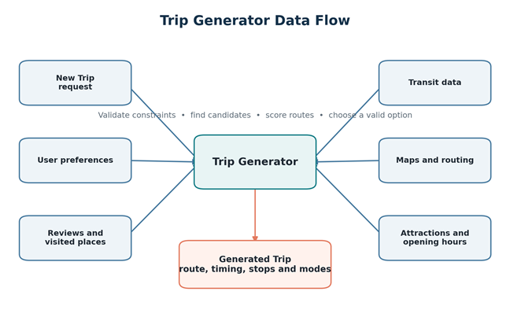
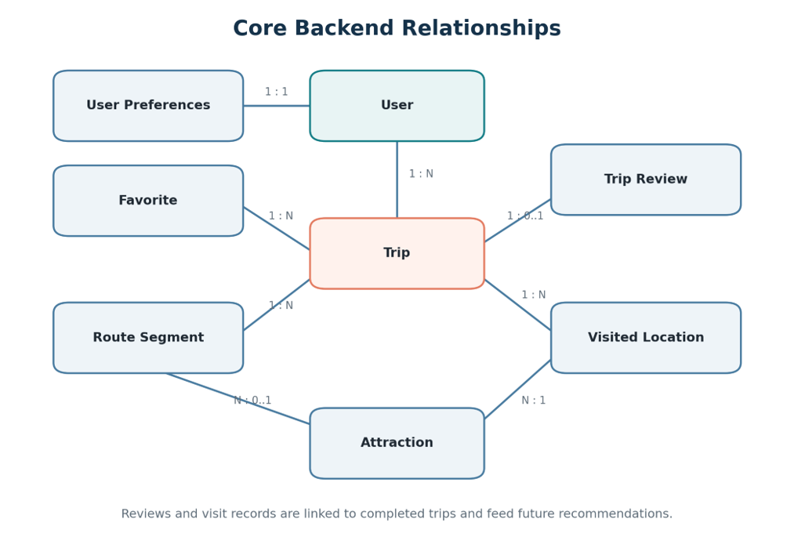
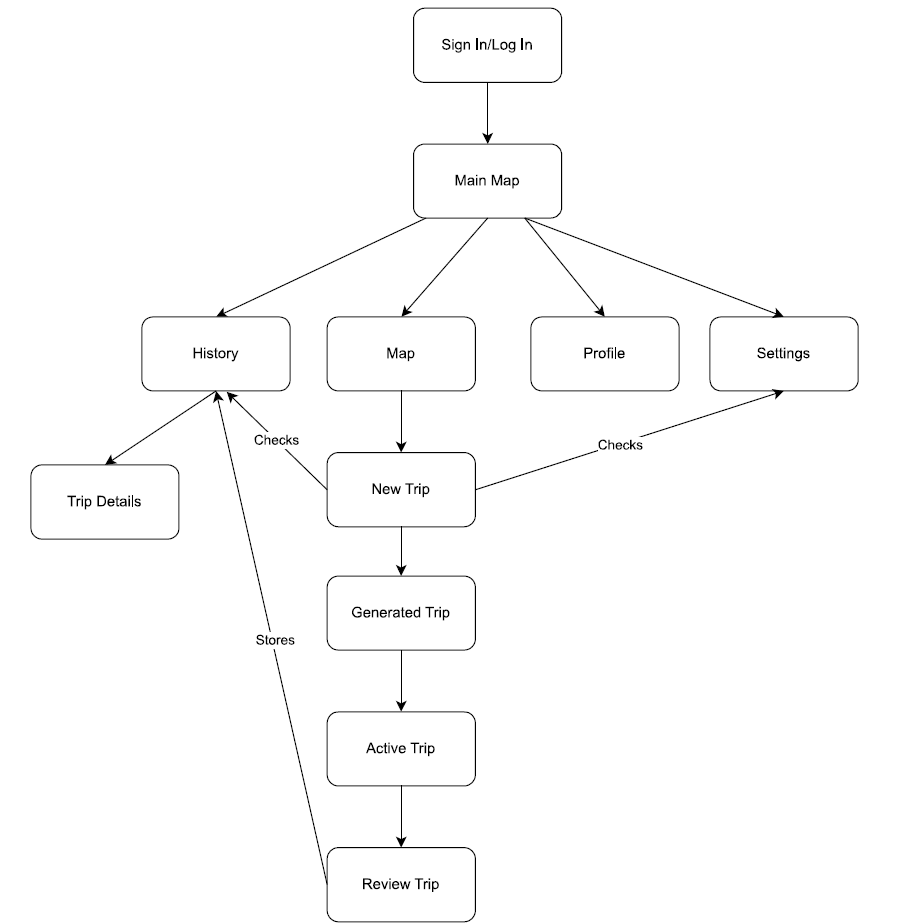

# TransitRandomizer Greater MontrГ©al Design Document

**Team:** Jimmy, Caio, Artiom  
**Project:** RNDTransitMTL  
**Updated:** 2026-10-27

TransitRandomizer generates achievable, semi-random adventures around Greater MontrГ©al using the user's available time, location, transportation choices, interests, and previous feedback. The user chooses what kind of adventure they want; the application proposes a destination and a practical route instead of requiring a destination in advance.

This document defines the product concept, screen behavior, generation algorithm, data model, and proposed delivery sequence. It combines the original Word design document with the team's additional feature ideas and the current Figma interface decisions. Planned features below are requirements and proposals, not a claim that they are already implemented.

## Product purpose

The application helps people answer questions such as “Where can I explore in the next two hours?” or “What unfamiliar place can I reach using Metro and walking?” It combines local discovery, route planning, personalization, and controlled randomness.

The intended users include MontrГ©al residents, students seeking inexpensive activities, tourists, pedestrians, cyclists, public-transit users, and groups of friends. A useful adventure should fit the available time, match interests, avoid unnecessary repetition, and remain practical to complete.

Walking, bicycle, bus, Metro, train, and REM are planned transportation options. Car support remains an open decision. Several modes may be combined in one adventure. A **trip leg** means a section of the journey, regardless of its mode; walking is a transportation mode rather than a synonym for a leg.

## Feature scope

| Feature | Intended behavior | Scope |
| --- | --- | --- |
| Random trip generator | Select reachable candidate places, compare them with time, interests, and transport preferences, and return a destination with a route | Core |
| Adventure categories | Optional rich interests used in future recommendations | Nice to have |
| User preferences | Store transport choices and basic constraints; richer personalization follows later | Basic settings core; rich preferences Nice to Have |
| Trip history | Save generated and completed trips, display their routes on the map, and allow an editable version of a past trip | Core |
| Post-trip review | Offer a star rating and short written review, plus feedback on individual places and route sections | Core |
| Map and compass views | Offer full map navigation or minimal compass guidance | Must Have |
| Shake to open compass | Open the compass when the user shakes the phone during an active adventure | AI Level-Up |
| Topographic main map | Show terrain and elevation; let users target altitude ranges or viewpoints during hikes | Nice to Have |
| Local group adventures | Create/join a session with shared constraints and participant locations | AI Level-Up |
| User-selected points of interest | Accept a list of places that influences the generated adventure path | Nice to have |
| Shared quests and competition | Give groups a shared quest pool for cooperative or competitive games inspired by Jet Lag | Nice to have |

The proposed first release prioritizes a complete single-user journey through generation, preview, completion, history, and review. Compass, elevation, and group features remain part of the product design, with their delivery order described later.

## Main user journey

1. The user launches the application. The entry flow supports a guest path; login and registration can be added when account services are available.
2. The user arrives at the main map and chooses their available time, transport modes, and transit zones when using transit.
3. The user adjusts trip-specific settings or accepts their saved preferences.
4. GO requests a generated adventure using the current settings and location.
5. The preview shows a destination or sequence of stops, route, duration, distance, and transportation methods.
6. The user starts the adventure, regenerates it, edits the settings, or saves it for later.
7. During the adventure, the user follows the map or switches to the direction-only compass view. Shaking the phone opens the compass.
8. The user completes or ends the adventure and reaches the review page.
9. The user can give stars, write a short review, and rate places or route sections, or skip the review.
10. The trip is stored in History. Reviews and visited locations influence future recommendations.

## Navigation and visual design

The current design uses the **Figma top navigation**. Profile and History appear on the left; Settings appears on the right. A gradient GO shortcut appears between History and Settings only when the active screen is not Main. This shortcut returns to the existing main map and preserves trip selections. The GO action inside `GOBox` requests an adventure; it has a different purpose from the header shortcut.

Profile provides the **about app** action, which opens About. Transport modes toggle independently on Main; exact bus numbers and route restrictions belong in detailed Settings. Platform Back returns through the navigation stack.

The target bottom navigation contains Map, Compass, and Together. These destinations share one active trip. Compass and Together destinations remain to be implemented.

Use [the colour system](colours.md) for all palette tokens, semantic roles, the blue-to-lime GO gradient, and LINE Seed JP Regular/Bold typography. Shared Material Symbols drawables and the existing team photographs remain in use.

The attraction-intensity control represents how strongly the user wants exploration and attraction discovery to influence the route. Its precise relationship to low, medium, and high exploration remains to be finalized.

## Main-screen interaction
The main screen presents the map, available minutes, GO, transport-mode toggles, and a draggable preferences sheet. Pulling the sheet upward moves through three resting positions matching the Figma main_screen, routes, and preferences frames; expanded content scrolls independently. GO moves above the sheet, while the attraction-intensity slider remains the final preference band. Walking style and attraction selections are restorable draft values; the sample generator does not yet apply them to routes. A tappable handle provides an alternative to dragging. The map remains stationary beneath the sheet.

Transport modes appear in this order: Walk, Bike, Bus, Metro, Train, REM. Each mode toggles independently. Main does not require users to select bus numbers or individual transit routes.

When a transit mode is enabled, show Transit zones with Zone A, Zone B, Zone C, and Zone D. Require at least one zone before generating a transit request. Click a transit type to open its zone dropdown, click it again to close, and click another type to switch the open dropdown, as in As3. Closing a dropdown preserves its selections. Only one dropdown is open at a time; the dropdown uses a 500 ms eased vertical slide in each direction. Switching modes finishes collapsing the old menu before expanding the next, with the latest click taking priority. Transport summaries stay on one line and use an ellipsis when selected zones exceed the button width, as in As3. Choosing a mode's first zone includes that mode, and clearing its last zone removes it. Bus, Metro, Train, and REM retain independent zone choices. Require at least one zone for every enabled transit mode. Preserve each mode's zone choices when the sheet moves or that mode is temporarily disabled. Restore older shared-zone drafts as the initial choice for each mode, then edit them independently. Generation snapshots retain the per-mode map and a combined zone list for legacy consumers. Zone restrictions apply to the transit journey, including transfers and intermediate travel, when supported by routing data.

Optional exact bus or route restrictions belong in detailed Settings. They are additional constraints, not a prerequisite for selecting a transit mode. Unsupported restrictions must be identified clearly rather than silently ignored.

The current sample-map generator can record zone selections but cannot validate geographic zone coverage. Geographic enforcement remains part of routing integration.

The shared top navigation contains Profile, History, and Settings. The target bottom navigation contains Map, Compass, and Together. These views share one active trip; switching views must not create another trip.

Use the palette and semantic roles in colours.md.
## Trip configuration and proposal alignment
The initial delivery generates one-way adventures. Required inputs are a valid starting location, positive whole minutes, and at least one supported transport mode. Transit requests additionally include selected zones under the updated main-screen design.

GO requests a proposal. The target preview offers Start Trip, Generate Another, and Edit Trip Settings. Generating a proposal must not itself mark the trip active. The existing sample flow currently starts a trip directly; introducing the preview boundary remains required implementation work.

Travel, waiting, transfers, planned visits, and an explicit allowance must fit the available duration. Return journeys and round-trip controls are outside the initial delivery.

The Milestone 2 Must-Haves include configuration, generation, preview, active-trip handling, persistent history, accounts and information screens, general settings, minimal compass guidance, and shared trip constraints. The AI Level-Ups are live map movement, shake-to-open compass, and group-session creation/joining.

Rich attraction preferences, personalization, favorites, terrain/elevation targets, selected points of interest, quests, and competition remain Nice-to-Have features. Showing a concept in Figma does not make its underlying service implemented.

The new zone-based Main interaction and foundations palette supersede the proposal's older route-expansion and colour descriptions. Record these as design changes in the next proposal revision.
## Required architecture: MVVM
The application must use Model–View–ViewModel with unidirectional data flow.
- Model: domain records, repository contracts, persistence, providers, and reusable business rules.
- View: composables render supplied state and send user actions through callbacks. Views own presentation details such as sheet position, scrolling, and animations.
- ViewModel: owns screen state, validates input, coordinates repository/use-case operations, and exposes read-only observable state.
Views must not generate trips, access storage, or own business decisions. ViewModels must not retain composables, platform views, activities, or navigation controllers. Navigation wiring belongs at the destination boundary.

Scope each ViewModel to its Navigation 3 entry. Keep application-wide trip state in one shared repository/store. A ViewModel must not create a second authoritative copy of the active trip.

Save planner drafts through a restoration mechanism and persist user defaults through a settings repository. A ViewModel alone does not provide persistence after process termination.
## Screen and component organization
Use the following structure under the existing shared Kotlin package:
```text
navigation/                  Router, Navigator, TripNavigation
layout/                      Shared scaffold, header, title; layout/previews/
View/<screen_name>/          Screen, content, components/, previews/
ViewModels/<screen_name>/    Screen state owners; MainPlannerState stays with its ViewModel
model/{trip,transport,review,planning,preferences,user,group}/
data/{repository,fake,generation,assets,local/entity,remote/dto}/
state/{trip,review,user}/
simulation/
ui/global_ui_ellements/{cards,ratings,media,trip,map,transitions,previews}/
ui/theme/
```

Each screen/view and its private components belong in the corresponding named screen folder. Components reused by multiple screens belong in ui/global_ui_ellements. Keep the spelling consistent with this project convention.

Theme definitions remain in ui/theme. Shared scaffold and navigation bars remain in layout; navigation state and destination wiring live in navigation.

The folder migration is implemented, including package/import updates across previews, tests, and target entry points. The complete filename tree is in [the coding guide](HowToWriteCode_InTheProject.md#32-module-and-package-boundaries). Empty future-feature directories contain no implementations. Legacy planner files remain for their previews; shared review media lives in `ui/global_ui_ellements/media/`. Moving a file into ViewModels does not make it a ViewModel; responsibilities must also change.
## Implementation status
The main-screen update introduces a draggable sheet, independent transport toggles, zone selection, and a ViewModel for planner selections.

Trip generation, validation feedback, and trip-opening coordination still require extraction from TransitOpeningScreen to complete the planner's MVVM migration.

The bundled map, normalized sample coordinates, and accelerated trip simulation remain prototype behavior. They do not demonstrate live geographic routing, live location tracking, geographic zone enforcement, or durable history storage.

## Screen requirements

### Launch and account entry

Show the application name and logo, a brief loading state, and location permission when required. Offer guest entry and, when implemented, login or registration. Continue to the main map. Account creation should not be required for the initial guest prototype.

### Main map

Display the user location or chosen starting point, nearby transit stops, lines, bicycle paths, interesting places, and the generated or active route. Completed routes can be shown when enabled. Keep trip generation and settings accessible from this screen.

A Nice-to-Have main-map style is **topographic**, with terrain and elevation information. Users should be able to select a desired altitude range, elevation target, or viewpoint for hiking adventures. Distinguish an absolute altitude target from total elevation gain. Both depend on elevation data and route coverage.

The first map prototype may use sample routes and markers before live location, topographic tiles, and routing are integrated. Group mode adds consenting members' locations to this map.

### Trip configuration

Collect a valid starting location, positive whole minutes, and at least one supported transport mode for a one-way adventure. Transit requests also require selected zones. Optional exact route restrictions belong in detailed Settings; rich attraction preferences and personalization remain backlog features. Return journeys and round-trip controls are future possibilities outside the initial delivery.

Topographic options add target altitude, acceptable elevation gain, and terrain preferences when supported. The optional points-of-interest list can contain places the user would like the generator to include. Required stops and suggested stops should be distinguished so a suggested place does not silently become a hard constraint.

Example request: “I have two hours, I am starting at John Abbott College, I can walk and use public transit, and I want to discover somewhere unusual.”

### Generated trip preview

Show the route, destination and intermediate stops, estimated duration and distance, transportation methods, visit time at each stop, and arrival time. When elevation is used, show the altitude target and estimated elevation gain.

Provide **Start Trip**, **Generate Another Trip**, **Edit Trip Settings**, and **Save for Later**. Explain which selected constraints prevented generation if no valid route is available.

### Active trip and compass

The map view shows current location, remaining route, current leg, next destination or transit stop, estimated remaining time, and progress. Actions include pause, skip a destination, end the trip, recalculate the remaining route, and open external navigation for detailed directions when available.

The **compass view hides the map, markers, trip controls, statistics, and ordinary navigation bars**. It shows a compass or direction arrow and a short prompt to follow that direction, creating the feeling of moving into the unknown. Keep an unobtrusive way to return to the map or end the adventure.

The direction should follow the next reachable waypoint on the planned route rather than always pointing directly through obstacles toward the final destination. The route remains active behind the minimal display, even while destination details are hidden.

Shaking the phone during an active adventure opens the compass. Add a deliberate button alternative for devices without usable motion sensors and for users who cannot shake the phone. Motion detection should reject ordinary movement and avoid reopening the compass repeatedly from a single shake. Shake sensitivity and whether shaking again returns to the map are open interaction decisions.

Later versions may recalculate when transit is delayed, a place is closed, the user skips a stop, spends longer than expected, or leaves the route. Compass mode uses the updated route after recalculation.

### Review trip

Open the review page after an adventure is completed or explicitly ended. Offer an overall **1–5 star rating** and a short written review. The user may skip either. The proposed star scale should be confirmed during interface design.

Retain the source document's detailed feedback on individual route legs and attractions: single tap selects a leg and opens its information; double tap can like it; dislike is available from the information panel. Leg feedback may cover walking, cycling, transit, streets, parks, waterfronts, viewpoints, and attractions. Distinguish liked and disliked sections visually and with labels.

Store reviews separately from the original trip. Overall stars and text complement the per-leg and per-attraction likes/dislikes. A skipped review leaves the trip saved without a rating.

External place ratings, such as Google, Tripadvisor, or Yelp, are an optional future integration and must be shown with their source. They remain distinct from ratings written inside TransitRandomizer.

### History and trip details

Store generated, saved, completed, and cancelled trips with their status. A history entry may show its date, duration, distance, transport modes, places visited, and overall rating. Opening it displays the route on the map.

Provide viewing, repeating, modifying, deleting, favoriting, and reviewing an unreviewed trip. Modification can change stops, time budget, or transport modes and request a new valid route. Keep the original completed route, actual travel record, and review intact; create an editable copy or revision linked to the original trip.

History records what happened. Favorites record routes or places that the user deliberately wants to keep. They are separate concepts.

### Preferences and settings

Transportation preferences include walking, bicycle, bus, Metro, train, and REM; car remains undecided. Adventure categories include popular attractions, hidden places, parks, architecture, food and cafГ©s, historic locations, nature, street art, waterfronts, interesting streets, and random exploration.

Restrictions include maximum walking and cycling distances, maximum duration, budget, avoiding highways or stairs, wheelchair accessibility, preferred bicycle infrastructure, indoor/outdoor choices, and late-night preferences. Elevation preferences add altitude and terrain requirements.

General settings include language, units, notifications, location permissions, privacy, deleting trip history, and deleting an account. Preference changes affect the next generation request. An active route changes only after the user requests or accepts recalculation.

### Profile and About

Profile can show username, image, completed-trip count, total distance and exploration time, visited neighbourhoods, and favorite modes, categories, and places. Account details and password controls belong here when authentication is implemented.

About is reached through Profile and introduces Caio, Artiom, and Jimmy using the existing photographs. Keep the provided “We make stuff” copy until the team supplies biographies.

Optional achievements include visiting ten MontrГ©al neighbourhoods, using every Metro line, completing 100 kilometres, visiting major parks, and completing trips with three transportation methods. Achievements are outside the initial proposed MVP.

### Local group adventures

Let a user create a nearby group session and let friends join. Participants share a generated adventure and see all members who have enabled location sharing on the map. Agree on the group's available time, categories, and transportation modes before generation. Respect the restrictions of every participant, including accessibility needs.

Joining and leaving a session should be explicit. Keep the group's route understandable if a participant disconnects, and indicate when a displayed location is stale. Group location sharing is limited to the session and its members.

As a **nice-to-have extension**, give the group a shared quest pool. Quests might ask members to reach a viewpoint, find public art, or visit selected places. Support cooperative completion or a competitive game inspired by Jet Lag. Scoring, completion evidence, teams, and deadlines remain design decisions.

“Local multiplayer” currently means nearby people taking an adventure together. Whether it uses a shared online service, local network, or direct device communication is undecided; offline multiplayer is not yet a requirement.

## Trip generation design

### Inputs

New Trip or the main `GOBox` action starts generation. The generator uses the confirmed origin, departure time, available one-way time, enabled transport modes, selected transit zones, and any allowed route IDs. Time, mode, route, zone, and access restrictions are mandatory. Attraction preferences, novelty, and previous visits affect scoring.

### Candidate selection

1. Validate the trip request before searching. Estimate the candidate search area from the available time and enabled modes. Use walking distance as an initial estimate and extend the search for cycling and transit where enabled.
2. For transit candidates, use STM and exo schedules and available real-time data to estimate which stops are reachable. Account for the walk to the first stop, initial wait, transfers, and the walk from the last stop to the destination. Keep walking and cycling candidates when enabled.
3. Sample buildings across the search area using an OpenStreetMap-derived dataset. For each building, find a nearby public road segment accessible by a permitted final travel mode. Place the destination on the road and retain its coordinates, the road segment ID, and the building ID. The trip does not require entering the building.
4. Deduplicate road endpoints and skip segments with known restrictions or closures. If the data cannot establish public access, skip the candidate. The search area limits candidate discovery. OTP determines whether a particular candidate is reachable.

### STM and exo routing data

Use STM and exo schedules as the routing baseline. Apply fresh trip updates and service alerts where available. Match reported vehicle positions to the scheduled trip where the provider supplies positions. Positions help assess service progress. Use stop-time predictions for departure and arrival estimates when available.

Request an OTP itinerary for each candidate using the planned departure time and allowed modes. If real-time predictions are missing or stale, use scheduled times and mark the itinerary as schedule-based. Continue to respect known cancellations, skipped stops, and closures. Keep API credentials in the backend or OTP feed configuration.

### Trip verification

`TripVerifier` checks each itinerary against the original request and approved candidate. Only trips that pass all checks enter the selection pool.

| Check | Verification |
| --- | --- |
| Reachability | OTP returned a complete itinerary from the confirmed origin to the candidate. |
| Actual endpoint | The returned geometry ends on the approved road segment within the configured snap tolerance. Reject an endpoint on another segment or across a barrier, even if it is nearby. |
| Building proximity | The actual endpoint is within the configured distance of the building footprint. |
| Access | The endpoint is on a public road accessible by the final leg's mode at arrival. Reject known closures or access restrictions that affect any leg. Reject candidates whose endpoint access cannot be verified. Temporary closure coverage depends on the available data. |
| Transit | Predicted or scheduled times leave enough time for transfers. Reject known cancelled services and skipped boarding or alighting stops. |
| Time and restrictions | Count travel, initial waiting, transfers, required visit time, and the timing buffer once. Verify the total fits the one-way budget and that modes, routes, and zones comply with the request. |

OTP can snap a requested coordinate to its network. Check the endpoint OTP actually returns before accepting a trip. Return a rejection reason and try another candidate within the configured attempt limit. Distinguish a routing service outage from a search that found no valid trip.

### Scoring and selection

Score verified routes for preference match, novelty, interestingness, and variety. Reduce the score of repeated or disliked places. Randomly choose among the highest-scoring verified routes. Personal feedback can influence results more than community ratings when enough data is available.

Return the selected trip's geometry, stops, modes, timing, and whether its transit timing uses schedules or real-time predictions. Refresh stale transit data and reverify the itinerary before starting the trip if the preview has been open past the configured refresh interval. If no candidate passes, explain the limiting constraint when known.

### Configuration and implementation

Keep tunable settings in `config/RNDPointChooser/`. Use named settings with explicit units, and comment why access, endpoint snapping, and feed freshness checks are needed.

| File | Settings |
| --- | --- |
| `CandidateSearchConfig.kt` | Search area parameters, candidate count and spacing, and maximum OTP attempts. |
| `TripVerifierConfig.kt` | Maximum distance to the building in metres, endpoint snap tolerance in metres, timing buffer, and allowed road categories. |
| `TripScoringConfig.kt` | Scoring weights and the size of the pool used for random selection. |
| `TransitRealtimeConfig.kt` | Feed freshness limits, transfer buffer, and preview refresh interval. |

1. Build the road and building lookup with stable IDs and access data for a small Montréal test area.
2. Implement `TripVerifier` and test it against map fixtures and OTP itinerary responses.
3. Connect `RNDPointChooser` to OTP, then connect verified results to the existing Trip Preview.
4. Test a valid public endpoint, a private driveway, a known closure, an endpoint snapped across a barrier, an over-budget route, a transit delay that breaks a transfer, stale feeds, and a routing outage. Use a fixed random seed in automated tests.



## Data model

These are proposed product entities. They describe required information without committing to a local database, remote backend, or specific service.

| Entity | Suggested fields |
| --- | --- |
| User | `userId`, `username`, `email`, `profileImage`, `createdAt`, `preferencesId`, `privacySettings` |
| UserPreferences | `preferencesId`, `userId`, `enabledTransportModes`, `selectedZoneIds`, optional `allowedRouteIds` for detailed Settings, `interestCategories`, `explorationLevel`, `maximumWalkingDistance`, `maximumCyclingDistance`, `budgetPreference`, `accessibilityRequirements`, `indoorOutdoorPreference`, `language`; proposed elevation preferences |
| TransportationMode | `transportModeId`, `type`, `category`, `routeName`, `stopOrStation`, `scheduledTime`, `estimatedTravelTime`, `availability` |
| Trip | `tripId`, `userId`, `status`, `startLocation`, `endLocation`, `startedAt`, `completedAt`, `estimatedDuration`, `actualDuration`, `estimatedDistance`, `actualDistance`, `transportModes`, `routeLegs`, `attractions`, `selectedZoneIds` (generation-time snapshot), `isFavorite`; proposed origin/revision link for editable copies |
| RouteLeg | `legId`, `tripId`, `orderNumber`, `transportMode`, `startCoordinates`, `endCoordinates`, `geometry`, `estimatedDuration`, `actualDuration`, `distance`, `relatedAttractionId`; proposed elevation measurements |
| Attraction or InterestingSpot | `attractionId`, `name`, `coordinates`, `category`, `description`, `rating`, `popularity`, `interestingnessScore`, `typicalVisitDuration`, `openingHours`, `priceLevel`, `accessibilityInformation`, `source`; proposed altitude |
| TripReview | `reviewId`, `tripId`, `userId`, `overallRating`, `createdAt`, `routeLegRatings`, `attractionRatings`; add `reviewText` for the short review |
| VisitedLocation | `visitedLocationId`, `userId`, `attractionId`, `tripId`, `visitedAt`, `visitCount`, `lastRating` |
| Favorite | `favoriteId`, `userId`, `itemType`, `tripId` or `attractionId`, `createdAt` |

Trip status values are **Draft**, **Generated**, **Active**, **Paused**, **Completed**, and **Cancelled**. Overall review ratings use the proposed star scale or no rating; route-leg and attraction feedback use Like, Dislike, or No Rating.

A user has preferences and many trips. A trip has ordered route legs, attraction references, visit records, and an optional review. A leg may reference an attraction. Favorites belong to users and reference a trip or place. Editable copies link to their original trip rather than overwriting completed travel records.

Proposed extension entities are:

| Entity | Purpose and suggested information |
| --- | --- |
| AdventureRequest | Capture the settings used for generation, including positive whole minutes, starting location, transport, `selectedZoneIds`, optional `allowedRouteIds`, and one-way timing for the initial delivery; rich categories, altitude and place constraints are future extensions |
| SelectedPointOfInterest | Record a user-selected attraction or coordinate and whether it is required or preferred |
| GroupSession | Session identifier, host, members, agreed constraints, shared trip, and session status |
| GroupMember | Session membership, display name, sharing consent, current location, last update time, and connection state |
| Quest | Optional objective, target place, completion rule, score, deadline, and cooperative or competitive mode |
| QuestCompletion | Optional member/team completion record, completion time, and validation state |

The source document's relationship diagram is preserved below. The table and extension definitions above include the new star reviews, editable history, elevation, and group concepts.



## Data sources and services

Potential integrations include map tiles and geocoding, routing, official transit schedules, real-time transit information, municipal open data, bicycle and pedestrian infrastructure, attraction information, elevation data, and community feedback from TransitRandomizer.

Prefer official APIs and GTFS or GTFS-Realtime feeds where available. Evaluate provider coverage, terms, attribution, rate limits, cost, and reliability before choosing services. External ratings and places should retain source attribution. Map, routing, topographic, and multiplayer providers remain open decisions.

Live feeds and exact provider integrations are not required to demonstrate the initial generation flow with clearly identified sample data. Stored history and reviews should remain available if a provider is offline.

## Quality requirements

- **Performance:** keep map interaction responsive, show progress during generation, and avoid blocking the interface during route calculations.
- **Usability:** require only a few selections for a simple adventure, keep core actions accessible, and explain generation failures. Compass view should be easy to enter and leave.
- **Reliability:** account for total adventure time, preserve saved trips, and handle missing schedules, unavailable routes, location errors, network failures, and stale group updates.
- **Privacy:** collect location history only when needed, explain stored location precision, support deletion, and avoid exposing personal routes in community analytics. Group sharing requires explicit participation.
- **Accessibility:** support screen readers, usable touch targets, readable LINE Seed JP text, and feedback indicators beyond color. Treat route accessibility restrictions as hard constraints and provide an alternative to shaking.

## Proposed delivery sequence

### Sprint 3: Foundations

Establish shared navigation, MVVM responsibilities, basic configuration, model/repository contracts, and the design foundations. Keep terrain and rich attraction categories in the backlog.

### Sprint 4: Core flow

Implement generation, a proposal preview with Start Trip / Generate Another / Edit Trip Settings, active-trip handling, durable history, accounts and information screens, and general settings. Generating a proposal must not activate it.

### Sprint 5: Tracking, groups, and Level-Ups

Integrate tracking, minimal compass guidance and shared trip constraints. Add live map movement, shake-to-open compass, and group-session creation/joining as the proposal's AI Level-Ups.

### Sprint 6: Testing and final delivery

Verify the complete journey, navigation, restoration, persistence, target-platform behavior, accessibility, and failure handling. Resolve defects and prepare the final delivery and supporting documentation.

Further possibilities from the source document include real-time replanning, weather-aware recommendations, community route discovery, achievements, social sharing, offline trip access, advanced safety controls, automatic detection of the travelled route, and push notifications.

## Open decisions

- Map, topographic, routing, transit, attraction, and elevation providers.
- Whether the first complete MVP uses live data or a controlled dataset.
- Local persistence, remote backend, account services, and guest-data behavior.
- Car support and how many transport combinations are practical for a given time budget.
- In-app versus external detailed navigation and reliable selection of route legs on the map.
- How attraction intensity maps to scoring and exploration levels.
- Altitude-range versus elevation-gain controls and provider coverage for hikes.
- Compass heading source, waypoint selection, shake sensitivity, and shake-again behavior.
- Required versus preferred stops in the optional place list.
- Final star scale, review-text length, and treatment of external place ratings.
- Group connection method, group size, mixed preferences, host departure, and reconnect behavior.
- Quest rules, scoring, teams, and evidence of completion for optional competitive play.
- Maybe we should add sort of sorting or filter on user's type of stm pass/ticket + price maybe

## Source references

Proposal alignment source supplied for this revision: `E:/CLouD MAIL/RNDTransitMTL_Milestone2_Proposal_Final (1).pdf`. The October 27 main-screen and foundations decisions supersede its older route-expansion and palette descriptions.

The base concept, original screen requirements, generator design, and nine core entities come from `TransitRandomizer_MTL_ed (3).docx`, supplied from `E:/CLouD MAIL/TransitRandomizer_MTL_ed (3).docx`. The shake compass, direction-only view, category-led adventures, optional place list, topographic altitude targeting, local group adventures, optional quests, editable history, and stars with a short review incorporate the team's added feature ideas.

The original navigation flow is retained as a product-journey reference. The current top-bar layout and additional compass/group features are defined in this document.



Related project documentation: [navigation implementation](navigation.md), [app colors](colours.md), and [Material Symbols resources](material-symbols.md).
